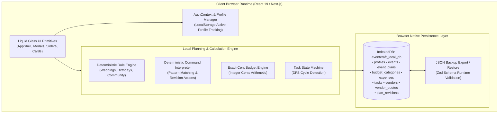

# EventCraft AI

> Local-first, browser-native event planning assistant for weddings, birthdays, and community gatherings.

EventCraft AI is a client-contained web application that delivers a complete event planning workspace directly inside your web browser. It combines archetype-driven planning templates, deterministic integer-cents budgeting, a phased task state machine with dependency resolution, multi-quote vendor tracking, and a conversational natural-language command interpreter.

The application operates on a **100% browser-local architecture** powered by native IndexedDB. All event data, calculations, rules, and revisions execute entirely on the client with **zero application backend, zero database daemons, and zero external cloud AI dependencies**.

---

[](tsconfig.json)
[](next.config.js)
[](package.json)
[](tailwind.config.js)
[-success?style=flat-square&logo=vitest&logoColor=white)](vitest.config.mts)
[-8A2BE2?style=flat-square)](src/lib/storage/indexed-db.ts)
[](src/lib/storage/local-repository.ts)
[](package.json)

---

## Table of Contents

- [Overview](#overview)
- [Key Features](#key-features)
- [Application Views and Routes](#application-views-and-routes)
- [System Architecture](#system-architecture)
- [Technology Stack](#technology-stack)
- [Project Structure](#project-structure)
- [Local Development Setup](#local-development-setup)
- [Environment Variables](#environment-variables)
- [Available Scripts and Testing](#available-scripts-and-testing)
- [Data Storage and Privacy](#data-storage-and-privacy)
- [Current Status and Roadmap](#current-status-and-roadmap)
- [Contributing](#contributing)
- [License](#license)
- [Acknowledgments](#acknowledgments)

---

## Overview

### The Problem
Traditional event planning often relies on fragmented tools: disconnected spreadsheets, arbitrary budget estimates prone to rounding errors, static checklists lacking dependency tracking, and unstructured vendor notes. Furthermore, modern cloud event planning platforms enforce mandatory subscriptions, account lock-in, and constant data sharing with third-party servers.

### The Solution
EventCraft AI unifies the entire planning lifecycle into a single cohesive, highly responsive interface:
- **Target Users**: Couples organizing weddings, families hosting milestone birthdays, non-profit organizers planning community fundraisers, and independent event coordinators.
- **100% Browser-Local Reliability**: Operates entirely in the browser using native IndexedDB. No mandatory cloud accounts, no external database dependencies to install, and zero network latency.
- **Financial Precision**: All financial calculations are tracked in exact integer cents, completely eliminating floating-point rounding errors and category reconciliation gaps.
- **Structured Execution**: Tasks follow a formal state machine organized into chronological phases, complete with directed graph dependency validation to prevent scheduling conflicts.
- **Deterministic Intelligence**: Generates structured blueprints, budgets, and itineraries using domain rule engines and pattern-matched command interpretation without cloud LLM inference or subscription APIs.

---

## Key Features

### 1. Archetype-Driven Event Wizard
- Guided 5-step event creation flow supporting three distinct event archetypes:
  - **Wedding**: Comprehensive vendor requirements, multi-phase ceremony and reception timelines, decor themes, and high-detail guest coordination.
  - **Birthday**: Milestone celebration themes, entertainment schedules, activity coordination, and catering tracking.
  - **Community Event**: Public gathering logistics, municipal permits, safety protocols, volunteer management, and accessible budget breakdowns.
- Collects guest headcounts, target budgets, currency preferences, dates, and stylistic themes.

### 2. Exact-Cent Budget Allocation and Financial Ledger
- **Integer-Cents Math**: Eliminates floating-point imprecision (`0.1 + 0.2 = 0.30000000000000004`) by computing all allocations, expenditures, and variances in integer minor units (cents).
- **Proportional Archetype Splits**: Automatically divides target budgets across archetype-specific categories (e.g., Venue, Catering, Photography, Decor, Entertainment, Contingency) with exact remainder cents allocated to primary categories to guarantee a 100.00% balance.
- **Expense Tracking**: Records individual expenses with payment tracking statuses (`PENDING`, `PAID`, `OVERDUE`), linked vendors, and real-time category variance monitoring.

### 3. Phased Task Management and Day-Of Runsheet
- **5 Planning Phases**: Tasks progress logically through `PLANNING` &rarr; `BOOKING` &rarr; `PREPARATION` &rarr; `EVENT_DAY` &rarr; `POST_EVENT`.
- **Dependency Graph Validation**: Enforces prerequisite constraints using a Depth-First Search (DFS) cycle-detection algorithm to ensure tasks cannot be marked complete out of order or blocked in circular deadlocks.
- **Hour-by-Hour Run of Show**: Generates an event-day itinerary with exact time slots, lead coordinators, logistical notes, and role assignments.

### 4. Vendor Directory and Quotation Comparison
- Directory supporting 11 vendor categories (Catering, Photography, Videography, Florist, Music/DJ, Venue, Hair & Makeup, Officiant, Transportation, Rentals, Planning).
- Multi-quote comparison tracking: records proposals, calculates minimum, average, and maximum bid metrics, and supports single-click quotation acceptance.

### 5. Conversational Command Interpreter
- Client-side natural language command parser allowing users to update their plan via quick text commands without clicking through multiple menus:
  - `add task [title]` &rarr; Adds a new task to the appropriate phase.
  - `complete task [title]` &rarr; Checks prerequisites and marks the task as complete.
  - `change date to [YYYY-MM-DD]` &rarr; Updates the event target date and recalculates dependent milestones.
  - `adjust budget to [amount]` &rarr; Reallocates category limits and updates ledger variances.
  - `add expense [title] [amount]` &rarr; Creates an expense item against the matching budget category.
  - `show remaining budget` &rarr; Returns an instant breakdown of allocated vs. spent funds.
  - `regenerate plan` &rarr; Re-runs the deterministic blueprint generator with confirmation guards.
  - `update theme [theme description]` &rarr; Updates event styling and decor direction.

### 6. Local Profile Management and Data Portability
- **Profiles**: Local user profiles with salt-hashed passcodes for convenient multi-user workspace separation on shared devices.
- **JSON Backup Export**: Download the entire application state (all 9 IndexedDB stores) into a timestamped `.json` file (`eventcraft-backup-YYYY-MM-DD.json`).
- **Schema-Validated Restore**: Import backups with runtime structural validation using Zod schemas.
- **Database Reset**: Safe one-click purge to clear local storage and start fresh.

---

## Application Views and Routes

The application features a translucent "Liquid Glass" design system built with custom Tailwind CSS utility tokens, responsive layouts, and accessible fallbacks.

| Route | View | Description |
| :--- | :--- | :--- |
| `/` | **Landing Page** | Product introduction, architectural summary, feature highlights, and quick-start actions. |
| `/dashboard` | **Event Dashboard** | Central overview displaying active event countdowns, budget health meters, and upcoming tasks. |
| `/events` | **Event Selector** | List of all planned events with quick status cards and switcher options. |
| `/events/new` | **Event Wizard** | Step-by-step creation flow for configuring archetype, dates, guests, and initial budget. |
| `/planner` | **Plan and Revisions** | Concept narrative, themes, color palettes, recommendations, and conversational revision command console. |
| `/budget` | **Budget Ledger** | Interactive category allocation sliders, expense logging modal, and variance calculation tables. |
| `/timeline` | **Timeline and Runsheet** | Phased milestone task checklists with dependency badges alongside the hour-by-hour day-of Run of Show. |
| `/vendors` | **Vendor Directory** | Contact tracking, quote comparison matrices, and vendor status progression pipeline. |
| `/settings` | **Settings and Backup** | Profile switcher, passcode configuration, atomic JSON backup export, and backup restore. |
| `/login` | **Profile Login** | Profile selection with optional passcode verification. |
| `/register` | **Profile Registration** | Quick creation of new local profiles stored securely in the browser. |

> [!TIP]
> To view the live interface, start the development server using `start.bat` or `npm run dev` and navigate to `http://localhost:3000`.

---

## System Architecture

EventCraft AI operates on a **100% client-side, browser-native architecture**. All business logic, persistence, and state transitions execute directly within the user's browser runtime.



### Architectural Principles
1. **Zero Runtime Network Dependencies**: The application triggers zero HTTP requests (`fetch()`, `axios`, or `XMLHttpRequest`) to external servers or cloud services during normal operation.
2. **Zero Database Configuration**: No PostgreSQL, MySQL, Docker containers, or database daemons are required. All records persist natively in browser IndexedDB.
3. **Deterministic Math and Rules**: Budget balancing, task dependencies, and plan generation use deterministic algorithms that produce identical, verified results without floating-point errors.
4. **Data Ownership and Privacy**: Event details, guest counts, vendor quotes, and budget figures never leave the user's machine.

---

## Technology Stack

### Frontend and Client Runtime
- **Framework**: [Next.js 15.2.1](https://nextjs.org/) (Static page generation, client-rendered App Router)
- **UI Library**: [React 19.0.0](https://react.dev/) (Hooks, Context API, Client Components)
- **Styling**: [Tailwind CSS 3.4.17](https://tailwindcss.com/) with custom Liquid Glass design tokens and [PostCSS 8.4.38](https://postcss.org/)
- **Icons**: [Lucide React 1.16.0](https://lucide.dev/)
- **Class Utilities**: `clsx` and `tailwind-merge`

### Local Persistence and Planning
- **Persistence**: Native Browser [IndexedDB API](https://developer.mozilla.org/en-US/docs/Web/API/IndexedDB_API) (Database: `eventcraft_local_db`, 9 dedicated object stores) with an in-memory fallback for SSR and testing
- **Schema Validation**: [Zod 3.24.2](https://zod.dev/) for form validation, blueprint constraints, and backup file integrity
- **Planning Engines**: Custom deterministic rule engine and natural-language command interpreter

### Quality and Testing
- **Test Framework**: [Vitest 5.0.5](https://vitest.dev/) with native ESM configuration
- **Type Checking**: [TypeScript 5.7.3](https://www.typescriptlang.org/) (Strict mode enabled)
- **Linting**: [ESLint 9.21.0](https://eslint.org/) with `eslint-config-next`

---

## Project Structure

```text
EventCraft AI/
├── docs/                           # Architectural specifications and guides
│   ├── ARCHITECTURE.md             # System architecture & domain boundaries
│   ├── DATA_MODEL.md               # Data model reference
│   ├── DEPLOYMENT_GUIDE.md         # Deployment runbook
│   ├── TESTING_GUIDE.md            # Test suite catalogue & execution guide
│   └── USER_FLOWS.md               # User journeys & state transition diagrams
├── prisma/                         # Historical schema reference (inactive at runtime)
│   ├── schema.prisma               # Prisma data model reference
│   └── migrations/                 # Version-controlled SQL migrations
├── src/
│   ├── app/                        # Next.js App Router client pages
│   │   ├── layout.tsx              # Root HTML layout and context providers
│   │   ├── page.tsx                # Landing and presentation page
│   │   ├── globals.css             # Tailwind directives & glassmorphic tokens
│   │   ├── dashboard/              # Active event overview and metrics
│   │   ├── events/                 # Event list and creation wizard (/events/new)
│   │   ├── planner/                # Concept viewer & command revision console
│   │   ├── budget/                 # Category sliders and expense ledger
│   │   ├── timeline/               # Phased milestones & day-of runsheet
│   │   ├── vendors/                # Vendor directory & quotation comparisons
│   │   ├── settings/               # Profile management & JSON backup export/import
│   │   └── login/ & register/      # Local profile selection screens
│   ├── components/                 # React component library
│   │   ├── ui/                     # 14 reusable glass UI primitives (Button, Modal, etc.)
│   │   ├── layout/                 # AppShell, Header, Sidebar, AuthContext
│   │   ├── events/                 # Event creation wizard & plan display
│   │   ├── planner/                # Conversational revision command panel
│   │   ├── budget/                 # Financial cards, allocation sliders, modals
│   │   ├── timeline/               # Task checklists, dependency tags, runsheet
│   │   └── vendors/                # Vendor cards, quote tables, dialogs
│   ├── lib/                        # Core business logic and storage services
│   │   ├── storage/                # IndexedDB engine, local repository, types, tests
│   │   ├── local-planning/         # Rule engine, command interpreter, schema, tests
│   │   ├── budget/                 # Exact-cent financial arithmetic & tests
│   │   ├── timeline/               # Task state machine & DFS cycle detection
│   │   ├── vendors/                # Vendor schemas and quote comparison logic
│   │   ├── validations/            # Zod validation schemas & tests
│   │   ├── navigation.ts           # Navigation items and route definitions
│   │   └── utils.ts                # Class merger and currency formatting utilities
│   └── types/                      # Shared TypeScript interface definitions
├── start.bat                       # Automated Windows launcher script
├── vitest.config.mts               # Vitest test runner configuration
├── next.config.js                  # Next.js configuration & HTTP security headers
├── tailwind.config.js              # Tailwind styling configuration
├── tsconfig.json                   # TypeScript compiler configuration
└── package.json                    # Project dependencies, scripts, and metadata
```

---

## Local Development Setup

### Prerequisites
- **Node.js**: `v20.x` or `v22.x` or higher (verified on Node `v22+` and `v26+`).
- **Package Manager**: `npm` (`v10+`).
- **Operating System**: Windows, macOS, or Linux.
- **Database**: **None required**. EventCraft AI does not require PostgreSQL, Docker, or any database daemon.
- **API Keys**: **None required**. EventCraft AI does not require OpenAI, Gemini, or external API keys.

---

### Step 1: Clone and Navigate to the Repository

```bash
git clone https://github.com/nithinpanuganti/EventCraft.git
cd EventCraft
```

---

### Step 2: Install Dependencies

```bash
# On Windows:
npm.cmd install

# On macOS / Linux:
npm install
```

---

### Step 3: Configure Environment Variables

```bash
# On Windows Command Prompt:
copy .env.example .env

# On Windows PowerShell, macOS, or Linux:
cp .env.example .env
```

The application runs immediately out of the box with default settings.

---

### Step 4: Start the Development Server

#### Option A: One-Click Launcher (Windows)
Double-click `start.bat` in the root folder, or execute it in your terminal:

```cmd
start.bat
```

The launcher verifies Node.js, installs dependencies if missing, ensures `.env` exists, and starts the development server.

#### Option B: Standard npm Command (All Platforms)

```bash
# On Windows (Command Prompt or PowerShell):
npm.cmd run dev

# On macOS / Linux:
npm run dev
```

> [!NOTE]
> If you encounter `File ... npm.ps1 cannot be loaded because running scripts is disabled` on Windows PowerShell, run `npm.cmd run dev` or run PowerShell with `Set-ExecutionPolicy -Scope Process -ExecutionPolicy Bypass`.

Once the dev server compiles, open your browser and navigate to:
**[http://localhost:3000](http://localhost:3000)**

---

## Environment Variables

All configuration settings are managed via environment variables. Refer to [`.env.example`](.env.example) for reference:

| Variable | Description | Required? | Default / Example Value |
| :--- | :--- | :---: | :--- |
| `NEXT_PUBLIC_APP_NAME` | Display name of the application. | Optional | `EventCraft AI` |
| `NEXT_PUBLIC_APP_ENV` | Application environment mode (`development`, `production`). | Optional | `development` |
| `NEXT_PUBLIC_APP_URL` | Canonical URL of the application. | Optional | `http://localhost:3000` |

> [!NOTE]
> EventCraft AI requires zero backend connection strings, authentication secrets, or external API keys.

---

## Available Scripts and Testing

All scripts are configured in [`package.json`](package.json) and can be executed using `npm`:

```bash
# Run the Next.js development server
npm run dev

# Execute the complete automated test suite (Vitest)
npm test

# Run TypeScript compiler type check without emitting output
npm run type-check

# Run Next.js and ESLint code quality checks
npm run lint

# Build the optimized production application bundle
npm run build

# Start the Next.js production server
npm run start
```

### Verified Test Suite Breakdown
EventCraft AI includes a test suite covering unit math, dependency resolution algorithms, storage persistence, schema validation, command interpretation, and zero-network verification.

**Current Test Results**: **76 passed** across **9 test files** (100% success rate):

| Category | Test Suite File | Count | Verified Behaviors |
| :--- | :--- | :---: | :--- |
| **Storage Architecture** | `src/lib/storage/browser-architecture.test.ts` | 5 | Zero network requests verification, profile switching/deletion, event cascade cleanup, corrupted backup rejection, navigation route integrity |
| **IndexedDB Engine** | `src/lib/storage/indexed-db.test.ts` | 4 | IndexedDB CRUD, memory fallback, versioned backup export, and schema-validated restore |
| **Local Repository** | `src/lib/storage/local-repository.test.ts` | 4 | Passcode hashing, event scoping, task dependencies, vendor quotes, and budget CRUD |
| **Rule Engine** | `src/lib/local-planning/rule-engine.test.ts` | 5 | Wedding, Birthday, and Community deterministic blueprints, exact-cent balanced budget allocation, zero-budget division safety |
| **Command Interpreter**| `src/lib/local-planning/command-interpreter.test.ts` | 9 | Natural language commands (`add task`, `complete task`, `change date`, `adjust budget`, `add expense`, `regenerate plan`, `update theme`, `show remaining budget`), unsupported command guidance |
| **Financial Engine** | `src/lib/budget/financial.test.ts` | 12 | Integer-cents arithmetic, category variance, zero-budget division safety, overruns |
| **Timeline Engine** | `src/lib/timeline/task-state-machine.test.ts` | 16 | Transition state machine, cyclic dependency detection (DFS), prerequisite chains |
| **Wizard Validation** | `src/lib/validations/wizard.test.ts` | 15 | 5-step event wizard schema boundaries, budget limits, future date constraints |
| **General Validation** | `src/lib/validations/validations.test.ts` | 6 | Input schemas and partial update guardrails |
| **Total** | **9 Suites** | **76** | **All 76 tests passing (100% success rate)** |

---

## Data Storage and Privacy

EventCraft AI prioritizes user privacy and data ownership through clear storage boundaries:

1. **Client-Contained Storage**:
   All event details, guest counts, budget numbers, vendor quotes, and profile records are stored directly inside your browser's IndexedDB engine (`eventcraft_local_db`). No data is transmitted to external servers, cloud providers, or telemetry collectors.
2. **Object Stores**:
   Data is partitioned across 9 distinct IndexedDB object stores:
   - `profiles`: User names, emails, and salt-hashed passcodes.
   - `events`: Event titles, archetypes, dates, guest counts, and total budgets.
   - `event_plans`: Concept narratives, themes, color palettes, and day-of schedules.
   - `budget_categories`: Cents-allocated category limits and percentage weights.
   - `expenses`: Individual expense items, payment statuses, and vendor links.
   - `tasks`: Phased checklist items, priorities, due dates, and dependency arrays.
   - `vendors`: Vendor contact information, categories, and booking status.
   - `vendor_quotes`: Itemized quotes submitted by vendors.
   - `plan_revisions`: Audit history of modifications made via command revisions.
3. **Local Profiles as Workspaces**:
   Profiles provide convenient workspace separation for different planners or events on a shared browser. Because profiles reside in browser storage, they are not intended as cryptographic security boundaries against users with access to browser developer tools.
4. **Storage Reset and Browser Clearing**:
   Clearing site data or cache for `localhost` in your browser will erase local IndexedDB stores. To ensure your plans are preserved, use the **Export Backup (.json)** feature in `/settings` to save an atomic copy to your local drive.

---

## Current Status and Roadmap

### Implemented and Verified Capabilities
- [x] 100% Browser-local architecture with zero runtime API or database dependencies.
- [x] Multi-archetype event planning wizard (Weddings, Birthdays, Community Events).
- [x] Complete client persistence with 9 IndexedDB stores and SSR in-memory fallback.
- [x] Exact-cent integer budgeting engine with guaranteed zero-rounding-error balancing.
- [x] Phased task state machine with DFS cyclic dependency prevention.
- [x] Hour-by-hour day-of Run of Show schedule generator.
- [x] Vendor directory with quotation comparison and status pipelines.
- [x] Conversational command interpreter for natural-language plan adjustments.
- [x] Atomic JSON database backup export and schema-validated restore.
- [x] Translucent Liquid Glass design system built with responsive Tailwind CSS.
- [x] Automated Windows launcher script (`start.bat`) with dependency verification.
- [x] Automated test suite with 76 passing tests across 9 suites.

### Planned Enhancements
- [ ] Export of Day-of Run of Show to iCal (`.ics`) and printable PDF formats.
- [ ] Seating chart builder with drag-and-drop table arrangements.
- [ ] Multi-event timeline overlap calendar view.
- [ ] Customizable archetype template creator.

---

## Contributing

Contributions to EventCraft AI are welcome. To contribute:

1. **Fork the Repository**: Create a personal fork on GitHub.
2. **Create a Feature Branch**:
   ```bash
   git checkout -b feature/your-feature-name
   ```
3. **Adhere to Code Standards**:
   - Write clear, typed TypeScript code.
   - Maintain the Liquid Glass design aesthetic and component hierarchy.
   - Ensure all features operate entirely within the browser without introducing backend endpoints.
   - Add unit tests in `src/lib/` for any new logic or algorithms.
4. **Run Verification Commands**:
   ```bash
   npm run type-check
   npm run lint
   npm test
   npm run build
   ```
5. **Submit a Pull Request**: Provide a clear description of the problem solved and test results.

---

## License

This repository is currently marked as `"private": true` in [`package.json`](package.json). All rights are reserved. An open-source license has not yet been specified.

---

## Acknowledgments

EventCraft AI is built with modern open-source software and tools:
- [Next.js](https://nextjs.org/) by Vercel for the client-side App Router architecture.
- [React](https://react.dev/) by Meta.
- [Tailwind CSS](https://tailwindcss.com/) by Tailwind Labs.
- [Lucide Icons](https://lucide.dev/) for UI iconography.
- [Vitest](https://vitest.dev/) for unit and integration testing.
- [Zod](https://zod.dev/) for TypeScript-first schema declaration and validation.