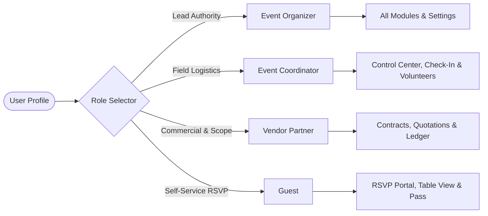
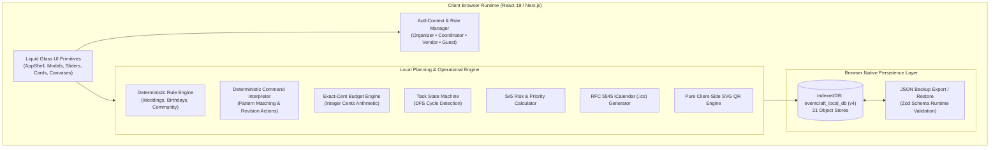

# EventCraft AI

> Local-first, browser-native event planning and multi-role management suite for weddings, birthdays, corporate galas, and community gatherings.

EventCraft AI is a client-contained web application that delivers a complete event planning and operations workspace directly inside your web browser. It combines archetype-driven planning templates, deterministic integer-cents budgeting, a phased task state machine with dependency resolution, multi-role user workspaces (Organizer, Coordinator, Vendor, Guest), interactive seating and venue layout designers, live day-of control center operations, and a conversational natural-language command interpreter.

The application operates on a **100% browser-local architecture** powered by native IndexedDB across **21 dedicated stores**. All event data, calculations, rules, documents, and revisions execute entirely on the client with **zero application backend, zero database daemons, and zero external cloud AI dependencies**.

---

[](tsconfig.json)
[](next.config.js)
[](package.json)
[](tailwind.config.js)
[-success?style=flat-square&logo=vitest&logoColor=white)](vitest.config.mts)
[](src/lib/accessibility/accessibility-and-quality.test.ts)
[-8A2BE2?style=flat-square)](src/lib/storage/indexed-db.ts)
[](src/lib/storage/local-repository.ts)
[](next.config.js)
[](package.json)

---

## Table of Contents

- [Overview](#overview)
- [Multi-Role System](#multi-role-system)
- [Key Features](#key-features)
- [Application Views and Routes](#application-views-and-routes)
- [System Architecture](#system-architecture)
- [IndexedDB Persistence Schema (21 Stores)](#indexeddb-persistence-schema-21-stores)
- [Technology Stack](#technology-stack)
- [Project Structure](#project-structure)
- [Local Development Setup](#local-development-setup)
- [Environment Variables](#environment-variables)
- [Available Scripts and Testing](#available-scripts-and-testing)
- [Data Storage and Privacy](#data-storage-and-privacy)
- [Static Deployment (Netlify)](#static-deployment-netlify)
- [Current Status and Roadmap](#current-status-and-roadmap)
- [Contributing](#contributing)
- [License](#license)
- [Acknowledgments](#acknowledgments)

---

## Overview

### The Problem
Traditional event planning often relies on fragmented tools: disconnected spreadsheets, arbitrary budget estimates prone to rounding errors, static checklists lacking dependency tracking, separate seating and ticketing tools, and unstructured vendor notes. Furthermore, modern cloud event planning platforms enforce mandatory subscriptions, account lock-in, and constant data sharing with third-party servers.

### The Solution
EventCraft AI unifies the entire planning and operational lifecycle into a single cohesive, highly responsive interface:
- **Target Users**: Event organizers, day-of coordinators, vendor partners, and guests attending weddings, birthday galas, corporate gatherings, and community events.
- **100% Browser-Local Reliability**: Operates entirely in the browser using native IndexedDB. No mandatory cloud accounts, no external database dependencies to install, and zero network latency.
- **Multi-Role Workspaces**: Distinct user profiles, permission scopes, and dedicated view perspectives for Organizers, Coordinators, Vendors, and Guests.
- **Financial Precision**: All financial calculations are tracked in exact integer cents, completely eliminating floating-point rounding errors and category reconciliation gaps.
- **Structured Execution**: Tasks follow a formal state machine organized into chronological phases, complete with directed graph dependency validation to prevent scheduling conflicts.
- **Deterministic Intelligence**: Generates structured blueprints, budgets, and itineraries using domain rule engines and pattern-matched command interpretation without cloud LLM inference or subscription dependencies.

---

## Multi-Role System

EventCraft AI provides distinct user experiences with dedicated permissions, navigation menus, and workflows:



### Demonstration Sample Accounts

EventCraft AI comes pre-configured with four local demonstration identities. Each persona includes pre-seeded relationships, tasks, quotations, and invitations:

| Role | Name | Username | Password | Dedicated Dashboard & Scope |
| :--- | :--- | :--- | :--- | :--- |
| **Event Organizer** | **Olivia Organizer** | `organizer.demo` | `organizer123` | [`/dashboard/organizer`](src/app/dashboard/organizer/page.tsx) • 9 widgets, full governance over budgets, seating, contracts, and audit reports. |
| **Event Coordinator** | **Ethan Coordinator** | `coordinator.demo` | `coordinator123` | [`/dashboard/coordinator`](src/app/dashboard/coordinator/page.tsx) • 6 widgets, day-of runsheet execution, volunteer check-in, and incident desk. |
| **Vendor Partner** | **Sophia Vendor** | `vendor.demo` | `vendor123` | [`/dashboard/vendor`](src/app/dashboard/vendor/page.tsx) • 6 widgets, assigned bookings, quotation proposals, signed contracts, and payment balances. |
| **Invited Guest** | **Liam Guest** | `guest.demo` | `guest123` | [`/dashboard/guest`](src/app/dashboard/guest/page.tsx) • 4 widgets, formal invitation, interactive RSVP, dietary setup, Table 1 seating, and QR pass. |

> **Browser-Only Password Security**: Demonstration passwords are SHA-256 hashed with a local salt before being written to IndexedDB. No plaintext passwords persist in storage.

### 1. Event Organizer (`ORGANIZER`)
- **Dedicated Dashboard ([`/dashboard/organizer`](src/app/dashboard/organizer/page.tsx))**: 9 widgets tracking Total Events, Upcoming Events, Completed Events, Total Budget, Actual Spending, Remaining Budget, Confirmed Guests, Pending Tasks, and Vendor Bookings.
- **Full Operational Scope**: Create and manage events, budgets, timeline tasks, vendor contracts, invitations, seating charts, and risk matrices.
- **Executive Analytics**: Access 6 audit reports (Executive Summary, Budget Audit, Guest Roster, Vendor Settlement, Task Execution, Post-Event Settlement) with CSV export and print view.
- **Global Settings**: Configure profiles, export atomic JSON backups, and manage application preferences.

### 2. Event Coordinator (`COORDINATOR`)
- **Dedicated Dashboard ([`/dashboard/coordinator`](src/app/dashboard/coordinator/page.tsx))**: 6 widgets tracking Assigned Events, Pending Tasks, Completed Tasks, Overdue Tasks, Upcoming Activities, and Active Issues.
- **Field Command**: Access the live Day-of Control Center with ticking clocks, countdown timers, runsheet task completion toggles, and incident desks.
- **Guest Ingress**: Live QR Check-in console with arrival progress meters and camera/manual verification.
- **Volunteers & Staff**: Manage shifts, stations, and volunteer check-ins.
- **Emergency Directory**: Rapid access to law enforcement, fire, medical, venue operations, and key organizers.
- **Boundary Restriction**: Strictly isolated from organizer financial settings and company budget ledgers.

### 3. Vendor Partner (`VENDOR`)
- **Dedicated Dashboard ([`/dashboard/vendor`](src/app/dashboard/vendor/page.tsx))**: 6 widgets tracking Total Bookings, Pending Quotations, Confirmed Bookings, Upcoming Services, Pending Balance Due, and Completed Services.
- **Commercial Visibility**: View assigned contracts, quotation comparisons, and payment milestone terms.
- **Payment Ledger**: Real-time financial balances tracking total committed funds, advance disbursements, and outstanding balances.
- **Direct Support**: Instant emergency contacts and coordinator dial links.
- **Boundary Restriction**: Restricted strictly to own vendor bookings and agreements.

### 4. Guest (`GUEST`)
- **Dedicated Dashboard ([`/dashboard/guest`](src/app/dashboard/guest/page.tsx))**: 4 widgets tracking Total Invitations, Confirmed Events, Pending Responses, and Upcoming Events.
- **Self-Service RSVP Portal**: Submit RSVPs (`CONFIRMED`, `DECLINED`), declare dietary preferences (e.g. Nut Allergy, Vegetarian), and accessibility requirements.
- **Personalized Table Locator**: View assigned table numbers, seating arrangements, and tablemates.
- **Digital Pass**: Display client-side generated QR pass for rapid entrance check-in.
- **Boundary Restriction**: Restricted from back-of-house planning tools and vendor contracts.

### 5. Centralized Role-Based Access Control (RBAC)
- Implemented in [`src/lib/permissions.ts`](src/lib/permissions.ts) defining 27 operational permissions and allowed route boundaries.
- Protected by [`RoleGuard.tsx`](src/components/layout/RoleGuard.tsx) intercepting unauthorized route access with an accessible **403 Access Restricted** interface.

---

## Key Features

### 1. Archetype-Driven Event Wizard
- Guided 5-step event creation flow supporting distinct event archetypes:
  - **Wedding**: Ceremony and reception timelines, decor themes, vendor requirements, and high-detail guest coordination.
  - **Birthday**: Milestone celebration themes, entertainment schedules, activity coordination, and catering tracking.
  - **Community Event**: Public gathering logistics, municipal permits, safety protocols, volunteer management, and accessible budget breakdowns.
- Collects guest headcounts, target budgets, currency preferences, dates, and stylistic themes.

### 2. Exact-Cent Budget Allocation and Financial Ledger
- **Integer-Cents Math**: Eliminates floating-point imprecision (`0.1 + 0.2 = 0.30000000000000004`) by computing all allocations, expenditures, and variances in integer minor units (cents).
- **Proportional Archetype Splits**: Automatically divides target budgets across archetype-specific categories with exact remainder cents allocated to primary categories to guarantee a 100.00% balance.
- **Expense Tracking**: Records individual expenses with payment tracking statuses (`PENDING`, `PAID`, `OVERDUE`), linked vendors, and real-time category variance monitoring.

### 3. Guest Management & RSVP Tracker ([`/guests`](src/app/guests/page.tsx))
- **Live Metrics**: Total Guests, Confirmed, Declined, Pending, Checked In, and Dietary Requirements.
- **Roster Management**: Full CRUD for guests with contact details, category tags (`VIP`, `Family`, `Friends`, `Colleagues`, `Other`), plus-one allocations, dietary preferences, and seating references.
- **Search, Filter & Sort**: Filter by RSVP status, category, table assignment, or search by name and email.
- **CSV Data Exchange**: Instant client-side CSV export and template-aware CSV import.
- **Guest Self-Service Portal**: Accessible via `?view=rsvp` allowing guests to confirm attendance and specify dietary needs directly.

### 4. Interactive Seating Arrangement Planner ([`/seating`](src/app/seating/page.tsx))
- **Table Studio**: Support for Round, Rectangular, and Custom table geometries with configurable seat capacities and VIP designations.
- **Interactive Seating**: Assign unseated guests to table chairs with real-time capacity limit enforcement.
- **Smart Grouping**: One-click **Auto-Assign Families & Groups** algorithm to seat guests with shared affinities or surnames together.
- **Printable Seating Chart**: Clean, paper-optimized print layout for venue door staff.
- **Guest Perspective View**: Accessible via `?view=guest` for attendees to view their table number and tablemates.

### 5. Invitation & RSVP Page Builder ([`/invitations`](src/app/invitations/page.tsx))
- **5 Liquid-Glass Invitation Themes**:
  1. *Classic Wedding Romance* (Rose Gold & Warm Champagne)
  2. *Milestone Birthday Celebration* (Neon Violet & Vibrant Magenta)
  3. *Corporate Gala & Summit* (Deep Navy & Polished Silver)
  4. *Golden Gathering Celebration* (Amber Glow & Emerald Accent)
  5. *Modern Minimalist Luxe* (Slate Monochromatic & Translucent Glass)
- **Customizer Suite**: Real-time editor for titles, host names, date/time, dress codes, custom messages, and styling themes.
- **Pure Client-Side SVG QR Code Generator**: Built using [`QrCodeSvg.tsx`](src/components/ui/QrCodeSvg.tsx) with zero external network or image dependencies, generating standard QR matrices encoding the guest RSVP URL.
- **Download & Print Preview**: High-resolution print mode for physical card production.

### 6. Event-Day Control Center ([`/control-center`](src/app/control-center/page.tsx))
- **Live Browser Clock & Event Countdown**: Real-time ticking timekeeper tracking hours until event kickoff.
- **Runsheet Checklist**: Categorized timeline items with immediate status transitions (`TODO`, `IN_PROGRESS`, `COMPLETED`, `BLOCKED`).
- **Incident Resolution Desk**: Rapid incident logging with severity levels (`LOW`, `MEDIUM`, `HIGH`, `CRITICAL`), assignee tracking, and status workflows (`OPEN`, `INVESTIGATING`, `RESOLVED`).
- **Quick-Dial Emergency Speed Panel**: Immediate telephone links to security, medical staff, venue directors, and key leads.

### 7. Vendor Contracts & Payment Tracking ([`/vendors`](src/app/vendors/page.tsx))
- **4 Tabbed Workspaces**:
  1. **Vendor Directory**: Contact cards, service categories, and assigned ratings.
  2. **Quotation Comparison**: Side-by-side quotation evaluation with scope and pricing metrics.
  3. **Contracts & Terms**: Contract numbers, advance payments, payment schedules, cancellation terms, and status badges (`DRAFT`, `PENDING_SIGNATURE`, `SIGNED`, `COMPLETED`).
  4. **Payment Ledger**: Financial balance sheet tracking total committed funds, advance amounts paid, and remaining balances due.

### 8. Interactive 2D Venue Layout Designer ([`/venue-layout`](src/app/venue-layout/page.tsx))
- **Spatial Canvas**: Interactive 2D drag-and-drop floor plan designer.
- **Venue Element Catalog**: Stages, Dance Floors, Round Tables, Rectangular Tables, Buffet Counters, Bars, DJ Booths, and Emergency Exits.
- **Canvas Controls**: Element rotation ($0^\circ-360^\circ$), dimension resizing, grid snapping ($20\text{px}$ alignment), zoom in/out ($50\%-150\%$), and canvas centering.
- **IndexedDB Persistence**: Automatically saves and restores multi-element floor plans to local storage.

### 9. Risk & Contingency Manager ([`/risks`](src/app/risks/page.tsx))
- **5x5 Likelihood vs. Severity Matrix**: Color-coded risk assessment grid calculating priority scores ($1 - 25$) and assigning levels:
  - *Low* ($1-5$), *Medium* ($6-10$), *High* ($12-16$), *Critical* ($20-25$).
- **Matrix Filtering**: Clicking any matrix cell filters the risk register to only risks matching that exact coordinate.
- **Mitigation & Contingency Plans**: Detailed mitigation steps, fallback plans, and status tracking (`IDENTIFIED`, `MITIGATING`, `RESOLVED`, `ACCEPTED`).

### 10. Event Analytics & Executive Reports ([`/analytics`](src/app/analytics/page.tsx))
- **Executive Metric Cards**: Budget utilization percentage, RSVP response rate, task completion rate, open incident count, and critical risk index.
- **6 Formal Audit Reports**:
  1. *Executive Summary Report*
  2. *Budget Audit & Variance Report*
  3. *Guest Attendance & Dietary Roster*
  4. *Vendor Settlement & Contract Summary*
  5. *Task Execution Audit*
  6. *Post-Event Settlement Statement*
- **Export & Print**: One-click CSV generation and printer-friendly view for all reports.

### 11. Additional Operations Modules
- **QR Check-In Console & Digital Pass** ([`/check-in`](src/app/check-in/page.tsx)): Fast search, real-time arrival progress bar, QR code token simulator, manual check-in toggle, and guest digital pass mode (`?view=pass`).
- **Volunteer & Staff Roster** ([`/volunteers`](src/app/volunteers/page.tsx)): Manage volunteer assignments across stations (Registration, Ushers, Stage, Catering) with check-in and shift completion tracking.
- **Document Vault** ([`/documents`](src/app/documents/page.tsx)): Browser-local file storage converting PDFs and images into Base64 data URLs stored in IndexedDB with category filters and download capability.
- **Emergency Contacts Directory** ([`/emergency-contacts`](src/app/emergency-contacts/page.tsx)): Categorized directory of Police, Fire, Medical, Security, and Venue contacts with 1-click `tel:` links.
- **Calendar .ICS Exporter** ([`src/lib/calendar/ics-export.ts`](src/lib/calendar/ics-export.ts)): RFC 5545 compliant `.ics` calendar generator integrated into the [`/events`](src/app/events/page.tsx) cards.

### 12. Conversational Command Interpreter
- Client-side natural language command parser allowing users to update their plan via quick text commands:
  - `add task [title]` &rarr; Adds a new task to the appropriate phase.
  - `complete task [title]` &rarr; Checks prerequisites and marks the task as complete.
  - `change date to [YYYY-MM-DD]` &rarr; Updates the event target date and recalculates dependent milestones.
  - `adjust budget to [amount]` &rarr; Reallocates category limits and updates ledger variances.
  - `add expense [title] [amount]` &rarr; Creates an expense item against the matching budget category.
  - `show remaining budget` &rarr; Returns an instant breakdown of allocated vs. spent funds.
  - `regenerate plan` &rarr; Re-runs the deterministic blueprint generator with confirmation guards.
  - `update theme [theme description]` &rarr; Updates event styling and decor direction.

### 13. Accessibility & WCAG 2.2 Level AA Compliance
- **Table Semantics (WCAG 1.3.1)**: Every data table across all modules includes explicit `scope="col"` on all 71 header cells (`<th>`) and contextual `aria-label`s for screen reader navigation.
- **Modal Dialog Semantics (WCAG 2.1.1, 4.1.2)**: All 10 modal dialogs feature `role="dialog"`, `aria-modal="true"`, `aria-labelledby`, explicit close button labels, and keyboard `Escape` dismissal.
- **Skip Navigation (WCAG 2.4.1)**: Prominent "Skip to main content" link for keyboard and screen reader users with focused landmark transfer.
- **Form Controls & Action Labels (WCAG 4.1.2)**: Explicit `<label htmlFor="...">` associations on credentials inputs, with descriptive contextual `aria-label`s on icon-only buttons (`aria-hidden="true"` on SVGs).

### 14. Data Security, RFC 4180 & CWE-1236 Defense
- **CWE-1236 Formula Injection Neutralization**: Automatic single-quote prefixing (`'`) for fields starting with `=`, `+`, `-`, `@`, `\t`, `\r` prevents formula execution in Excel/Google Sheets.
- **RFC 4180 Compliance**: Parser properly preserves quotes containing commas, escaped quotation marks (`""`), and multiline fields.
- **Runtime Validation Type Guards**: Strict type guard functions (`isUserRole`, `isGuestCategory`, `isRsvpStatus`, etc.) validate imported and stored records.
- **Unified 5×5 Risk Scoring**: Centralized priority calculations with matrix boundary clamping.

---

## Liquid Glass Design System

EventCraft AI features a cohesive, premium **Liquid Glass** user interface designed for depth, optical translucency, and spatial hierarchy:

### Surface Hierarchy
- **Canvas / Ambient Backdrop**: Multi-stop radial ambient light mesh combining violet (`rgba(139, 92, 246, 0.12)`), indigo (`rgba(99, 102, 241, 0.10)`), and amber (`rgba(245, 158, 11, 0.06)`) glow fields layered over a microscopic hardware-accelerated refraction grid.
- **Navigation Shell**: Frosted sticky headers (`.glass-header`) and luminous sidebars (`.glass-sidebar`) with multi-layer backdrop blur (`blur(20px)`), subtle translucent borders, and glowing active route indicator pills.
- **Primary Glass Cards**: Semi-transparent surface containers (`.glass-card`, `.glass-surface`) utilizing `backdrop-filter: blur(16px)` with internal specular top edge highlights (`.specular-top`).
- **Elevated Overlays**: Modal dialogs, auth panels, and command consoles (`.glass-surface-elevated`) with deep elevation shadows (`shadow-glass-elevated`) and focused backdrop dimming.
- **Subtle Panels & Controls**: Translucent interactive pills, chips, and secondary cards (`.glass-surface-subtle`) for dense tables, quote rows, and form inputs with visible focus rings.
- **Accessible Data Tables**: Specialized table containers (`.glass-table-wrapper`) maintaining high-contrast readable cell content without excessive per-cell blur overhead.
- **Motion & Accessibility**: All transitions use fluid CSS easings with full `@media (prefers-reduced-motion: reduce)` support.

---

## Application Views and Routes

| Route | View | Description |
| :--- | :--- | :--- |
| `/` | **Landing Page** | Product introduction, architectural summary, feature highlights, and quick-start actions. |
| `/dashboard` | **Adaptive Dashboard** | Central role router intelligently serving the active user's role-specific dashboard. |
| `/dashboard/organizer` | **Organizer Dashboard** | Executive planning command hub with 9 operational & financial widgets, budgets, and milestones. |
| `/dashboard/coordinator`| **Coordinator Dashboard**| Day-of operations console with 6 widgets, runsheet task toggles, and incident desk. |
| `/dashboard/vendor` | **Vendor Dashboard** | Commercial partner portal with 6 pipeline widgets, contract terms, and balance ledger. |
| `/dashboard/guest` | **Guest Dashboard** | Attendee portal with 4 widgets, interactive RSVP updater, seating card, and QR pass. |
| `/events` | **Event Selector** | List of all planned events with quick status cards, switcher options, and .ICS calendar export. |
| `/events/new` | **Event Wizard** | Step-by-step creation flow for configuring archetype, dates, guests, and initial budget. |
| `/planner` | **Plan & Revisions** | Concept narrative, themes, color palettes, recommendations, and conversational revision console. |
| `/budget` | **Budget Ledger** | Interactive category allocation sliders, expense logging modal, and variance calculation tables. |
| `/timeline` | **Timeline & Runsheet**| Phased milestone task checklists with dependency badges alongside the hour-by-hour day-of Run of Show. |
| `/guests` | **Guest Management** | Full guest roster CRUD, RSVP tracker, category tags, dietary logs, and CSV import/export. |
| `/seating` | **Seating Planner** | Table geometry manager, interactive seat assignment, capacity limits, and printable chart. |
| `/invitations` | **Invitation Builder** | 5 liquid-glass invitation themes, customizer studio, pure SVG QR generator, and download/print. |
| `/control-center` | **Control Center** | Live event-day clock, countdown, runsheet execution checklist, and incident desk. |
| `/vendors` | **Vendors & Contracts**| 4 workspaces: Directory, Quotation Comparison, Contracts & Terms, and Payment Ledger. |
| `/venue-layout` | **Venue Layout** | Interactive 2D drag-and-drop floor plan designer with rotation, grid snapping, and zoom. |
| `/risks` | **Risk Matrix** | 5x5 Likelihood vs Severity risk assessment matrix with mitigation and contingency plans. |
| `/analytics` | **Analytics & Reports** | Executive KPI cards and 6 formal audit reports with CSV download and print view. |
| `/check-in` | **Check-in Console** | QR scanner simulator, arrival progress bar, manual door checks, and guest digital pass mode. |
| `/volunteers` | **Volunteer Roster** | Volunteer shifts and station management with check-in and shift completion tracking. |
| `/documents` | **Document Vault** | Local Base64 file attachment storage with category filtering and instant download. |
| `/emergency-contacts`| **Emergency Directory**| Categorized directory of Police, Fire, Medical, Security, and Venue contacts with 1-click calls. |
| `/settings` | **Settings & Backup** | Role profile switcher, passcode configuration, atomic JSON backup export, and backup restore. |
| `/login` | **Role Gateway** | Central multi-role landing page with 4 visually distinct role cards and demo accounts. |
| `/register` | **Registration** | Role-specific profile registration stored securely in local browser storage. |
| `/login/organizer` | **Organizer Login** | Dedicated login page with credentials, show/hide password, and 1-click demo launcher. |
| `/login/coordinator` | **Coordinator Login**| Dedicated login page with credentials, show/hide password, and 1-click demo launcher. |
| `/login/vendor` | **Vendor Login** | Dedicated login page with credentials, show/hide password, and 1-click demo launcher. |
| `/login/guest` | **Guest Login** | Dedicated login page with credentials, show/hide password, and 1-click demo launcher. |

---

## System Architecture

EventCraft AI operates on a **100% client-side, browser-native architecture**. All business logic, persistence, and state transitions execute directly within the user's browser runtime.



---

## IndexedDB Persistence Schema (21 Stores)

The application manages local state across 21 dedicated IndexedDB object stores (Database version `4`):

1. `profiles`: User accounts, assigned roles (`ORGANIZER`, `COORDINATOR`, `VENDOR`, `GUEST`), and salt-hashed passcodes.
2. `auth_sessions`: Active user session tokens and timestamps.
3. `events`: Core event records, dates, guest counts, archetypes, and total budgets.
4. `event_plans`: Architectural concepts, decor palettes, and detailed schedules.
5. `budget_categories`: Integer-cents allocations, percentages, and baseline budgets.
6. `expenses`: Line-item expenditures, vendor links, and payment states.
7. `tasks`: Phased checklist milestones, priority levels, and dependency arrays.
8. `vendors`: Vendor contacts, services, categories, and ratings.
9. `vendor_quotes`: Itemized quotation bids and proposal metrics.
10. `plan_revisions`: Audit history of conversational revisions.
11. `guests`: Attendee profiles, RSVP statuses, plus-ones, dietary restrictions, and table links.
12. `tables`: Seating arrangements, table geometries (Round, Rectangular, Custom), and capacities.
13. `invitations`: Invitation designs, themes, typography, and custom greeting messages.
14. `vendor_contracts`: Formal agreements, advance deposits, milestones, and cancellation policies.
15. `vendor_payments`: Payment installment schedules and settlement statuses.
16. `vendor_quotations`: Vendor quotation comparison items.
17. `event_issues`: Day-of incident reports, severity levels, and resolution states.
18. `venue_layouts`: Interactive 2D floor plans, spatial coordinates, dimensions, and rotations.
19. `risks`: 5x5 Likelihood/Severity risk matrices, priority scores ($1-25$), and contingency plans.
20. `checkin_logs`: Timestamped guest arrival and check-in audit records.
21. `volunteers`: Volunteer rosters, assigned shifts, stations, and check-in statuses.
22. `documents`: Client-side Base64 file attachments, contracts, and municipal permits.
23. `emergency_contacts`: Emergency directory covering Police, Fire, Medical, Security, and Venue leads.

---

## Technology Stack

### Frontend and Client Runtime
- **Framework**: [Next.js 15.5.28](https://nextjs.org/) (Static HTML Export `output: 'export'`, client-rendered App Router)
- **Hosting & Static Export**: [Netlify](https://www.netlify.com/) (Configured with `netlify.toml` and `public/_headers`)
- **UI Library**: [React 19.0.0](https://react.dev/) (Hooks, Context, Client Components)
- **Styling**: [Tailwind CSS 3.4.17](https://tailwindcss.com/) with custom Liquid Glass design tokens and [PostCSS 8.4.38](https://postcss.org/)
- **Icons**: [Lucide React 1.16.0](https://lucide.dev/)
- **Class Utilities**: `clsx` and `tailwind-merge`

### Local Persistence and Planning
- **Persistence**: Native Browser IndexedDB (Database: `eventcraft_local_db`, 21 dedicated object stores) with an in-memory fallback for SSR and testing
- **Schema Validation**: [Zod 3.24.2](https://zod.dev/) for form validation, blueprint constraints, and backup file integrity
- **Planning Engines**: Custom deterministic rule engine and natural-language command interpreter
- **Calendar & QR Utilities**: RFC 5545 `.ics` generator and pure client-side SVG QR code generator

### Quality and Testing
- **Test Framework**: [Vitest 5.0.5](https://vitest.dev/) with native ESM configuration
- **Type Checking**: [TypeScript 5.8](https://www.typescriptlang.org/) (Strict mode enabled)
- **Linting**: [ESLint 9.21.0](https://eslint.org/) with `eslint-config-next`

---

## Project Structure

```text
EventCraft AI/
├── docs/                           # Architectural specifications and guides
│   ├── ARCHITECTURE.md             # System architecture & domain boundaries
│   ├── DATA_MODEL.md               # Data model reference
│   ├── DEPLOYMENT_GUIDE.md         # Deployment runbook
│   ├── TESTING_GUIDE.md            # Test suite catalogue & execution guide
│   └── USER_FLOWS.md               # User journeys & state transition diagrams
├── src/
│   ├── app/                        # Next.js App Router client pages (29 routes)
│   │   ├── layout.tsx              # Root HTML layout and context providers
│   │   ├── page.tsx                # Landing and presentation page
│   │   ├── globals.css             # Tailwind directives & glassmorphic tokens
│   │   ├── dashboard/              # Active event overview and metrics
│   │   ├── events/                 # Event list, creation wizard & .ics export
│   │   ├── planner/                # Concept viewer & command revision console
│   │   ├── budget/                 # Category sliders and expense ledger
│   │   ├── timeline/               # Phased milestones & day-of runsheet
│   │   ├── guests/                 # Guest management & RSVP portal (?view=rsvp)
│   │   ├── seating/                # Interactive table seating & print chart
│   │   ├── invitations/            # 5-theme invitation builder & SVG QR code
│   │   ├── control-center/         # Day-of live clock, runsheet & incident desk
│   │   ├── vendors/                # Directory, quotes, contracts & payment ledger
│   │   ├── venue-layout/           # 2D interactive spatial floor plan designer
│   │   ├── risks/                  # 5x5 Likelihood vs Severity risk matrix
│   │   ├── analytics/              # Executive KPI cards & 6 audit report generators
│   │   ├── check-in/               # QR scanner simulator & digital pass (?view=pass)
│   │   ├── volunteers/             # Volunteer shift & station management
│   │   ├── documents/              # Client-side Base64 document vault
│   │   ├── emergency-contacts/     # 1-click emergency contacts directory
│   │   ├── settings/               # Profile management & JSON backup export/import
│   │   ├── login/ & register/      # Multi-role login and registration screens
│   │   └── login/{role}/           # Role-specific entry shortcuts
│   ├── components/                 # React component library
│   │   ├── ui/                     # Glass UI primitives (Button, Modal, QrCodeSvg, etc.)
│   │   ├── layout/                 # AppShell, Header, Sidebar, AuthContext
│   │   ├── events/                 # Event creation wizard & plan display
│   │   ├── planner/                # Conversational revision command panel
│   │   ├── budget/                 # Financial cards, allocation sliders, modals
│   │   ├── timeline/               # Task checklists, dependency tags, runsheet
│   │   └── vendors/                # Vendor cards, quote tables, dialogs
│   ├── lib/                        # Core business logic and storage services
│   │   ├── storage/                # IndexedDB engine (21 stores), local repository, types
│   │   ├── local-planning/         # Rule engine, command interpreter, schema
│   │   ├── budget/                 # Exact-cent financial arithmetic
│   │   ├── timeline/               # Task state machine & DFS cycle detection
│   │   ├── vendors/                # Vendor schemas and quote comparison logic
│   │   ├── calendar/               # RFC 5545 iCalendar (.ics) export generator
│   │   ├── validations/            # Zod validation schemas
│   │   ├── navigation.ts           # Role-aware navigation items and routes
│   │   └── utils.ts                # Class merger and currency formatting utilities
│   └── types/                      # Shared TypeScript interface definitions
├── public/                         # Static deployment assets
│   └── _headers                    # Netlify security headers configuration
├── netlify.toml                    # Netlify build and publish configuration
├── start.bat                       # Automated Windows launcher script
├── vitest.config.mts               # Vitest test runner configuration
├── next.config.js                  # Next.js static export & compiler configuration
├── tailwind.config.js              # Tailwind styling configuration
├── tsconfig.json                   # TypeScript compiler configuration
└── package.json                    # Project dependencies, scripts, and metadata
```

---

## Local Development Setup

### Prerequisites
- **Node.js**: `v20.x` or `v22.x` or higher (verified on Node `v22+` and `v26+`).
- **Package Manager**: `npm` (`v10+`).
- **Operating System**: Windows, macOS, or Linux.
- **Database**: **None required**. EventCraft AI does not require PostgreSQL, Docker, or any database daemon.
- **Cloud Credentials**: **None required**. EventCraft AI does not require OpenAI, Gemini, or external credentials.

---

### Step 1: Clone and Navigate to the Repository

```bash
git clone https://github.com/nithinpanuganti/EventCraft.git
cd EventCraft
```

---

### Step 2: Install Dependencies

```bash
# On Windows:
npm.cmd install

# On macOS / Linux:
npm install
```

---

### Step 3: Configure Environment Variables

```bash
# On Windows Command Prompt:
copy .env.example .env

# On Windows PowerShell, macOS, or Linux:
cp .env.example .env
```

---

### Step 4: Start the Development Server

#### Option A: One-Click Launcher (Windows)
Double-click `start.bat` in the root folder, or execute it in your terminal:

```cmd
start.bat
```

#### Option B: Standard npm Command (All Platforms)

```bash
# On Windows (Command Prompt or PowerShell):
npm.cmd run dev

# On macOS / Linux:
npm run dev
```

Once the dev server compiles, open your browser and navigate to:
**[http://localhost:3000](http://localhost:3000)**

---

## Environment Variables

All configuration settings are managed via environment variables. Refer to [`.env.example`](.env.example) for reference:

| Variable | Description | Required? | Default / Example Value |
| :--- | :--- | :---: | :--- |
| `NEXT_PUBLIC_APP_NAME` | Display name of the application. | Optional | `EventCraft AI` |
| `NEXT_PUBLIC_APP_ENV` | Application environment mode (`development`, `production`). | Optional | `development` |
| `NEXT_PUBLIC_APP_URL` | Canonical URL of the application. | Optional | `http://localhost:3000` |

---

## Available Scripts and Testing

All scripts are configured in [`package.json`](package.json) and can be executed using `npm`:

```bash
# Run the Next.js development server
npm run dev

# Execute the complete automated test suite (Vitest)
npm test

# Run TypeScript compiler type check without emitting output
npm run type-check

# Run Next.js and ESLint code quality checks
npm run lint

# Build and statically export the production bundle into out/
npm run build

# Preview the production static export locally
npx serve out
```

### Verified Test Suite Breakdown
EventCraft AI includes a test suite covering unit math, dependency resolution algorithms, storage persistence, schema validation, command interpretation, multi-role navigation, calendar generation, CSV security, and WCAG accessibility standards.

**Current Test Results**: **106 passed** across **11 test files** (100% success rate):

| Category | Test Suite File | Count | Verified Behaviors |
| :--- | :--- | :---: | :--- |
| **Accessibility & Security** | `src/lib/accessibility/accessibility-and-quality.test.ts` | 17 | CSV formula injection defense (CWE-1236), RFC 4180 parsing, runtime type guards, 5×5 matrix scoring & clamping |
| **Financial Engine** | `src/lib/budget/financial.test.ts` | 12 | Integer-cents arithmetic, category variance, zero-budget division safety, overruns |
| **Timeline Engine** | `src/lib/timeline/task-state-machine.test.ts` | 16 | Transition state machine, cyclic dependency detection (DFS), prerequisite chains |
| **Multi-Role System** | `src/lib/storage/multi-role-system.test.ts` | 13 | Demo credentials verification, 4-role authentication, default dashboard resolvers, RBAC route guarding, 21-store hydration, CSV export/import integrity, RFC 5545 .ics generation |
| **Command Interpreter**| `src/lib/local-planning/command-interpreter.test.ts` | 9 | Natural language commands (`add task`, `complete task`, `change date`, `adjust budget`, `add expense`, `regenerate plan`, `update theme`, `show remaining budget`), unsupported command guidance |
| **Rule Engine** | `src/lib/local-planning/rule-engine.test.ts` | 5 | Wedding, Birthday, and Community deterministic blueprints, exact-cent balanced budget allocation, zero-budget division safety |
| **Storage Architecture** | `src/lib/storage/browser-architecture.test.ts` | 5 | Zero network requests verification, profile switching/deletion, event cascade cleanup, corrupted backup rejection, navigation route integrity |
| **IndexedDB Engine** | `src/lib/storage/indexed-db.test.ts` | 4 | IndexedDB CRUD, memory fallback, versioned backup export, and schema-validated restore |
| **Local Repository** | `src/lib/storage/local-repository.test.ts` | 4 | Passcode hashing, event scoping, task dependencies, vendor quotes, and budget CRUD |
| **Wizard Validation** | `src/lib/validations/wizard.test.ts` | 15 | 5-step event wizard schema boundaries, budget limits, future date constraints |
| **General Validation** | `src/lib/validations/validations.test.ts` | 6 | Input schemas and partial update guardrails |
| **Total** | **11 Suites** | **106** | **All 106 tests passing (100% success rate)** |

---

## Data Storage and Privacy

EventCraft AI prioritizes user privacy and data ownership through clear storage boundaries:

1. **Client-Contained Storage**:
   All event details, guest rosters, invitations, seating charts, budget figures, vendor contracts, risk registers, and profile records are stored directly inside your browser's IndexedDB engine (`eventcraft_local_db`). No data is transmitted to external servers, cloud providers, or telemetry collectors.
2. **Object Stores**:
   Data is partitioned across 21 distinct IndexedDB object stores supporting atomic queries and isolated cascading deletes.
3. **Local Profiles as Workspaces**:
   Profiles provide convenient workspace separation for different planners or roles on a shared browser.
4. **Storage Reset and Browser Clearing**:
   Clearing site data or cache for `localhost` in your browser will erase local IndexedDB stores. Use the **Export Backup (.json)** feature in `/settings` to save an atomic copy to your local drive.

---

## Static Deployment (Netlify)

EventCraft AI is fully prepared for static deployment on **Netlify** or any standard static web host:

### Architecture & Configuration
- **Static HTML Export**: `output: 'export'` and `trailingSlash: true` configured in [`next.config.js`](next.config.js).
- **Publish Directory**: `out/` generated on `npm run build` containing all 33 prerendered application routes.
- **Security Headers**: Defined in [`public/_headers`](public/_headers) (automatically copied to `out/_headers`) setting `X-Frame-Options: DENY`, `X-Content-Type-Options: nosniff`, and restrictive permissions policies.
- **Netlify Configuration**: [`netlify.toml`](netlify.toml) pre-specifies the build command (`npm run build`) and output folder (`out`).

---

## Current Status and Roadmap

### Implemented and Verified Capabilities
- [x] 100% Browser-local architecture with zero runtime server or database dependencies.
- [x] Multi-Role User System with 4 distinct roles (`ORGANIZER`, `COORDINATOR`, `VENDOR`, `GUEST`).
- [x] Separate dedicated dashboards for all 4 roles with role-specific widgets, metrics, and actions.
- [x] Separate dedicated login portals (`/login/organizer`, `/login/coordinator`, `/login/vendor`, `/login/guest`) with 1-click demo access.
- [x] Central role gateway page (`/login`) with 4 distinct liquid-glass cards.
- [x] Pre-configured demonstration accounts (Olivia Organizer, Ethan Coordinator, Sophia Vendor, Liam Guest).
- [x] Centralized Role-Based Access Control (RBAC) with route guards and 403 Access Restricted screens.
- [x] Complete client persistence across 21 IndexedDB stores with SSR in-memory fallback.
- [x] Guest Management & RSVP Tracker with CSV import/export and guest self-service portal.
- [x] Interactive Seating Arrangement Planner with smart group auto-assign & printable charts.
- [x] Invitation & RSVP Builder with 5 liquid-glass themes & pure client-side SVG QR generator.
- [x] Live Event-Day Control Center with browser clock, countdown, runsheet toggles, and incident desk.
- [x] Vendor Contracts & Payment Tracking with quotation comparisons and balance ledger.
- [x] 2D Interactive Venue Layout Designer with element rotation, grid snapping, and zoom.
- [x] Risk & Contingency Manager with 5x5 Likelihood vs Severity matrix and priority scoring.
- [x] Event Analytics & Executive Reporting with 6 official audit report generators and CSV/print export.
- [x] QR Check-In Console with arrival progress bar and guest digital pass mode.
- [x] Volunteer and Staff Roster management with shift and station tracking.
- [x] Client-side Document Vault converting files to Base64 data URLs in IndexedDB.
- [x] Categorized Emergency Contacts Directory with 1-click dial links.
- [x] RFC 5545 iCalendar (`.ics`) generator and export trigger.
- [x] Netlify static deployment ready with `out/` export (33 static routes), `netlify.toml`, and `public/_headers`.
- [x] Multi-archetype event planning wizard (Weddings, Birthdays, Community Events).
- [x] Exact-cent integer budgeting engine with guaranteed zero-rounding-error balancing.
- [x] Phased task state machine with DFS cyclic dependency prevention.
- [x] Conversational command interpreter for natural-language plan adjustments.
- [x] Translucent Liquid Glass design system built with responsive Tailwind CSS.
- [x] Automated test suite with 106 passing tests across 11 suites (100% pass rate).
- [x] WCAG 2.2 Level AA accessibility compliance across all modals, tables, landmarks, and icon buttons.
- [x] Comprehensive data security with CWE-1236 CSV formula injection defense and RFC 4180 parsing.
- [x] Robust runtime type guards for all data models and roles.

---

## Contributing

Contributions to EventCraft AI are welcome. To contribute:

1. **Fork the Repository**: Create a personal fork on GitHub.
2. **Create a Feature Branch**:
   ```bash
   git checkout -b feature/your-feature-name
   ```
3. **Adhere to Code Standards**:
   - Write clear, typed TypeScript code.
   - Maintain the Liquid Glass design aesthetic and component hierarchy.
   - Ensure all features operate entirely within the browser without introducing backend endpoints.
   - Add unit tests in `src/lib/` for any new logic or algorithms.
4. **Run Verification Commands**:
   ```bash
   npm run type-check
   npm run lint
   npm test
   npm run build
   ```
5. **Submit a Pull Request**: Provide a clear description of the problem solved and test results.

---

## License

This repository is currently marked as `"private": true` in [`package.json`](package.json). All rights are reserved.

---

## Acknowledgments

EventCraft AI is built with modern open-source software and tools:
- [Next.js](https://nextjs.org/) by Vercel for the client-side App Router architecture.
- [React](https://react.dev/) by Meta.
- [Tailwind CSS](https://tailwindcss.com/) by Tailwind Labs.
- [Lucide Icons](https://lucide.dev/) for UI iconography.
- [Vitest](https://vitest.dev/) for unit and integration testing.
- [Zod](https://zod.dev/) for TypeScript-first schema declaration and validation.