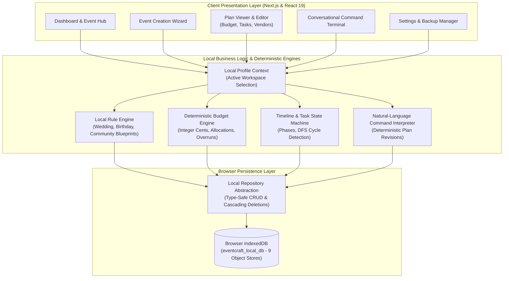
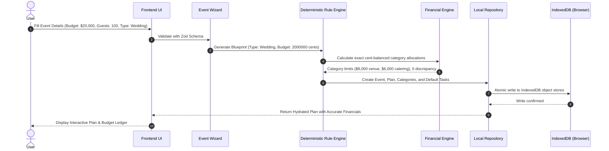

# System Architecture Specification
## Project: EventCraft AI

---

### 1. Architectural Principles

1. **Local-First Browser-Native Runtime:**
   - **Persistence Domain:** Browser-native IndexedDB (`eventcraft_local_db`) with 9 dedicated object stores and an in-memory fallback for SSR and testing.
   - **Deterministic Intelligence Domain:** Structured event blueprints, category allocations, milestone timelines, and day-of run-of-show itineraries generated using rule engines and command interpretation without external cloud dependencies.
   - **Principle:** *Zero external network requests or server endpoints are required during runtime execution.*

2. **Schema-First Contracts:**
   - All internal data models and backup exports are strictly validated using **Zod** schemas.
   - Database records maintain canonical typing across all object stores.

3. **Workspace Data Isolation:**
   - Browser profiles function as isolated workspaces within IndexedDB, scoping all events, budgets, tasks, and vendors to the active local profile.

4. **Exact-Cent Financial Precision:**
   - All monetary amounts are computed in integer cents to eliminate floating-point drift and ensure exact category reconciliation.

---

### 2. High-Level System Architecture Diagram

---

### 3. Logical Modules & Responsibilities

| Module | Primary Responsibilities | Dependencies |
| :--- | :--- | :--- |
| **1. Frontend & Dashboard** | Responsive Liquid Glass UI, Event Creation Wizard, Interactive Budget Ledger, Milestone Roadmap, Run-of-Show time blocks, Vendor directory. | React 19, Tailwind CSS, Lucide Icons, Zod |
| **2. Profile & Workspace** | Local profile creation/switching, persistent active profile state in IndexedDB. | React Context, IndexedDB |
| **3. Event Management** | CRUD operations for events, user preferences, status tracking (`PLANNING`, `ACTIVE`, `COMPLETED`, `ARCHIVED`). | Local Repository, IndexedDB |
| **4. Local Planning Engine** | Deterministic blueprint generation (`generateAndSaveLocalPlan`), domain archetype rules (Weddings, Birthdays, Community), cents-level balanced budget allocation, and milestone schedules. | Zod, Deterministic Rule Engine |
| **5. Budget Engine (Deterministic)** | Fixed-precision integer cents arithmetic, category percentage-to-dollar conversions, rounding reconciliation, actual expense tracking, remaining balance calculations, budget overrun alerts. | TypeScript integer math (cents) |
| **6. Timeline & Task Engine** | Milestone grouping, relative date offsets, task state machine (`TODO` &rarr; `IN_PROGRESS` &rarr; `COMPLETED`), directed graph dependency validation with cycle prevention. | Native Date & `Intl.DateTimeFormat` |
| **7. Vendor Management** | Category assignment, quote tracking, contact directory, status pipeline (`RESEARCHING` &rarr; `QUOTED` &rarr; `BOOKED`). | Local Repository, IndexedDB |
| **8. Validation & Backup** | Schema sanitization, backup JSON export and import validation with versioned schema checking. | Zod |

---

### 4. Deterministic Local Planning Flow

---

### 5. Error Handling & Resilience Matrix

| Failure Mode | Detection Point | Mitigation Strategy | User Experience |
| :--- | :--- | :--- | :--- |
| **Corrupted Backup JSON** | Zod Schema Validator | Validates version, structure, and object store arrays | Rejects invalid file with clear error toast notification. |
| **Budget Overrun** | Deterministic Budget Engine | Compares `TotalSpent` vs `TotalBudget` in cents | Prominent amber/red banner with exact overrun amount and highlighted categories. |
| **Cyclic Task Dependency** | Task State Machine | DFS cycle detection algorithm | Blocks invalid dependency assignment with helpful error message. |
| **IndexedDB Unavailable** | Storage Adapter | Graceful fallback to memory store | Functional execution during SSR and private browsing modes. |
