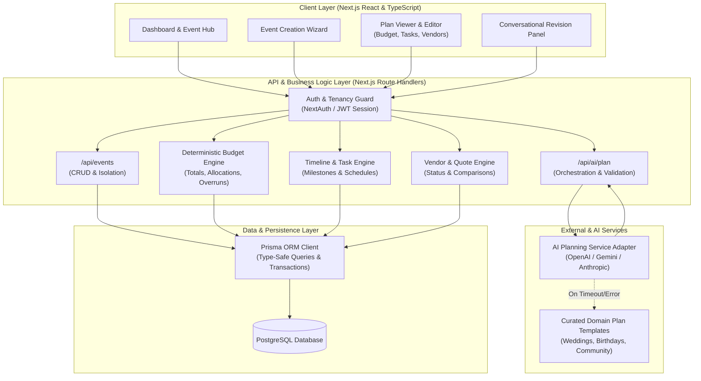
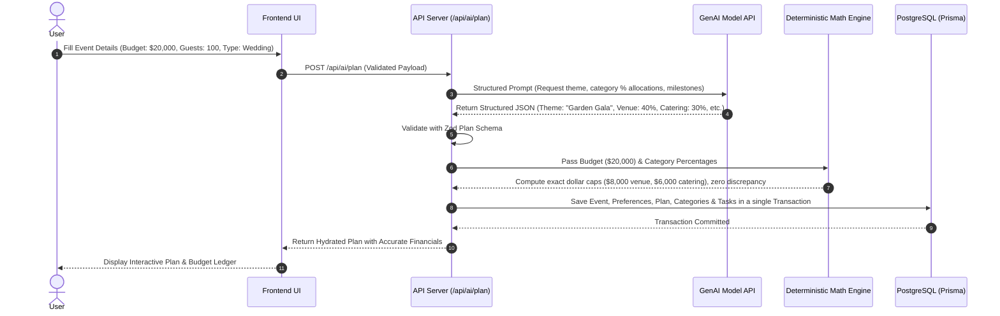

# System Architecture Specification
## Project: EventCraft AI

---

### 1. Architectural Principles

1. **Separation of Creative AI vs. Deterministic Business Logic:**
   - **GenAI Domain:** Concept brainstorming, theme descriptions, suggested category allocations (percentages), milestone suggestions, run-of-show sequence.
   - **Deterministic Code Domain:** Monetary balance calculations, sum of expenses, budget overrun alerts, calendar date arithmetic, user authorization, and relational database transactions.
   - **Principle:** *The AI never calculates the final wallet balance, and the database never executes unvalidated AI output.*

2. **Schema-First Contracts:**
   - All client-to-server and server-to-AI data exchanges are strictly validated using **Zod** schemas.
   - AI outputs are structured JSON adhering to precise schema definitions.

3. **Multi-Tenant Data Isolation:**
   - Every read and write query at the API/ORM layer is scoped by the authenticated user's ID (`userId`).

4. **Resilient AI Pipeline with Safe Fallbacks:**
   - Circuit breaker and retry mechanisms for LLM calls with automatic fallback to curated domain templates when offline or rate-limited.

---

### 2. High-Level System Architecture Diagram

---

### 3. Logical Modules & Responsibilities

| Module | Primary Responsibilities | Dependencies |
| :--- | :--- | :--- |
| **1. Frontend & Dashboard** | Responsive UI, Event Creation Wizard, Interactive Budget Ledger, Gantt/Milestone Roadmap, Run-of-Show time blocks, Vendor directory. | React, Tailwind CSS, Lucide Icons, Zod |
| **2. Auth & Tenancy** | User signup/login, session management, tenancy middleware (`where: { userId }`). | NextAuth.js / Secure Session Cookies |
| **3. Event Management** | CRUD operations for events, user preferences, status tracking (`PLANNING`, `ACTIVE`, `COMPLETED`, `ARCHIVED`). | Prisma ORM, PostgreSQL |
| **4. AI Planning Service** | Provider-independent architecture (`PlanningService`, `PlanningProvider`) supporting official Google Gemini & OpenAI SDKs. Prompt injection sanitization (`buildPlanningContext`), Zod schema validation (`GeneratedEventPlanSchema`), deterministic cents-level budget balancing & timeline calculation (`validateAndNormalizePlan`), and domain fallback recovery (`FallbackPlanService`). | `@google/generative-ai`, `openai`, `zod`, Curated Templates |
| **5. Budget Engine (Deterministic)** | Fixed-precision addition/subtraction, category percentage-to-dollar conversions, integer minor units (cents) rounding reconciliation, actual expense tracking, remaining balance calculations, budget overrun flag generation. | TypeScript core math (cents/integers) |
| **6. Timeline & Task Engine** | Milestone grouping, relative date offsets (e.g., `eventDate - 30 days`), status state machine (`TODO` &rarr; `IN_PROGRESS` &rarr; `DONE`), day-of run-of-show chronology. | Native Date & `Intl.DateTimeFormat` |
| **7. Vendor Management** | Category assignment, quote tracking, contact directory, status pipeline (`RESEARCHING` &rarr; `QUOTED` &rarr; `BOOKED`). | Prisma ORM |
| **8. Validation & Error Handling** | Client and server-side request sanitization, AI schema enforcement, standard HTTP error responses. | Zod |

---

### 4. Deterministic vs. AI Separation Details

---

### 5. Error Handling & Resilience Matrix

| Failure Mode | Detection Point | Mitigation Strategy | User Experience |
| :--- | :--- | :--- | :--- |
| **AI API Timeout (>15s)** | AI Planning Adapter | Abort controller triggers fallback | System alerts user: "AI is taking longer than usual. Loaded industry-standard starter plan with option to refine." |
| **Malformed AI JSON** | Zod Schema Parser | 1 automatic repair prompt; if fails, load template | Seamless fallback without raw error dump. |
| **Budget Overrun** | Deterministic Budget Engine | Compares `TotalSpent` vs `TotalBudget` | Prominent amber/red banner with exact overrun amount and suggested reduction categories. |
| **Unauthorized Access** | Auth Guard Middleware | Checks `event.userId === session.userId` | 403 Forbidden redirected to login/dashboard. |
| **Database Disconnection** | Prisma Client | Retry with exponential backoff | 503 Service Unavailable with friendly toast message. |
