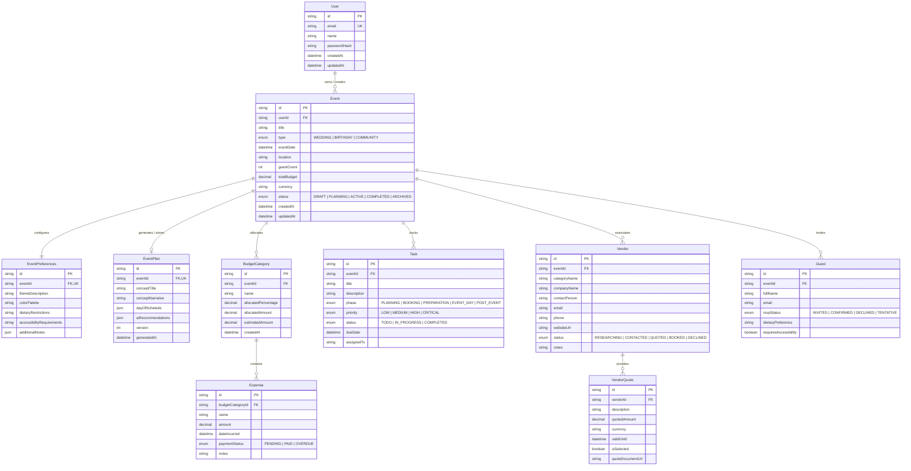

# Conceptual Data Model & Schema Plan
## Project: EventCraft AI

---

### 1. Conceptual Entity-Relationship Model



---

### 2. Entity Descriptions, Validation Rules & Ownership

#### A. `User`
- **Purpose:** Primary tenant and owner of all event assets.
- **Ownership:** Top-level root entity.
- **Key Validation:**
  - `email`: Valid RFC 5322 format, lowercase, unique.
  - Password hash: Salted bcrypt/argon2 hash (minimum 8 characters plaintext before hashing).

#### B. `Event`
- **Purpose:** Central entity representing an individual wedding, birthday, or community project.
- **Ownership:** Strictly owned by `User` (`userId` foreign key).
- **Key Validation:**
  - `title`: String, 3–120 characters, trimmed.
  - `type`: Enum (`WEDDING`, `BIRTHDAY`, `COMMUNITY`).
  - `eventDate`: Optional in draft, but must be in the future when set.
  - `guestCount`: Integer, $\ge 1$, $\le 50,000$.
  - `totalBudget`: Decimal $\ge 0.00$, stored as 2 decimal places (or integer cents in pennies).
  - `currency`: ISO 4217 code (3 chars, default: `USD`).

#### C. `EventPreferences`
- **Purpose:** Captures qualitative user choices, aesthetic direction, dietary constraints, and accessibility requirements.
- **Ownership:** $1:1$ with `Event`. Cascades on event deletion.
- **Key Validation:**
  - `dietaryRestrictions`: Sanitized string / comma-separated tags (e.g. `Vegetarian, Halal, Nut Allergy`).
  - `accessibilityRequirements`: Sanitized string (e.g. `Wheelchair ramp, ASL interpreter`).

#### D. `EventPlan`
- **Purpose:** Persists the AI-generated structured plan and revision versions.
- **Ownership:** $1:1$ with `Event`.
- **Key Validation:**
  - `dayOfSchedule`: Validated JSON array of `{ time: string, activity: string, lead: string, notes?: string }`.
  - `version`: Integer starting at 1, incremented upon conversational plan revisions.

#### E. `BudgetCategory` & `Expense`
- **Purpose:** Relational ledger for financial management.
- **Ownership:** `BudgetCategory` belongs to `Event`; `Expense` belongs to `BudgetCategory`.
- **Integrity Rules:**
  - Sum of `allocatedPercentage` across categories should ideally equal $100\%$ ($1.000$).
  - `allocatedAmount = (allocatedPercentage / 100) * Event.totalBudget`.
  - Category `SpentAmount = SUM(Expense.amount)`.
  - `Overrun = SpentAmount > allocatedAmount`.

#### F. `Task`
- **Purpose:** Actionable checklist item mapped to chronological event phases.
- **Ownership:** Belongs to `Event`.
- **Key Validation:**
  - `title`: String, 2–150 characters.
  - `phase`: Enum (`PLANNING`, `BOOKING`, `PREPARATION`, `EVENT_DAY`, `POST_EVENT`).
  - `status`: Enum (`TODO`, `IN_PROGRESS`, `COMPLETED`).
  - `priority`: Enum (`LOW`, `MEDIUM`, `HIGH`, `CRITICAL`).

#### G. `Vendor` & `VendorQuote`
- **Purpose:** Vendor directory and quotation comparison engine.
- **Ownership:** `Vendor` belongs to `Event`; `VendorQuote` belongs to `Vendor`.
- **Integrity Rules:**
  - `isSelected` quote must be unique or maximum 1 active selection per vendor.
  - No synthetic data: vendor records only created via user explicit input or saved search.

#### H. `Guest`
- **Purpose:** Headcount and dietary/accessibility requirement tally.
- **Ownership:** Belongs to `Event`.
- **Key Validation:**
  - `fullName`: String, 1–100 characters.
  - `rsvpStatus`: Enum (`INVITED`, `CONFIRMED`, `DECLINED`, `TENTATIVE`).

---

### 3. Planned Prisma Schema Implementation Blueprint
*(To be scaffolded and migrated in Phase 2/3 with direct PostgreSQL connection)*

```prisma
datasource db {
  provider = "postgresql"
  url      = env("DATABASE_URL")
}

generator client {
  provider = "prisma-client-js"
}

enum EventType {
  WEDDING
  BIRTHDAY
  COMMUNITY
}

enum EventStatus {
  DRAFT
  PLANNING
  ACTIVE
  COMPLETED
  ARCHIVED
}

enum TaskPhase {
  PLANNING
  BOOKING
  PREPARATION
  EVENT_DAY
  POST_EVENT
}

enum TaskPriority {
  LOW
  MEDIUM
  HIGH
  CRITICAL
}

enum TaskStatus {
  TODO
  IN_PROGRESS
  COMPLETED
}

enum VendorStatus {
  RESEARCHING
  CONTACTED
  QUOTED
  BOOKED
  DECLINED
}

enum PaymentStatus {
  PENDING
  PAID
  OVERDUE
}
```
