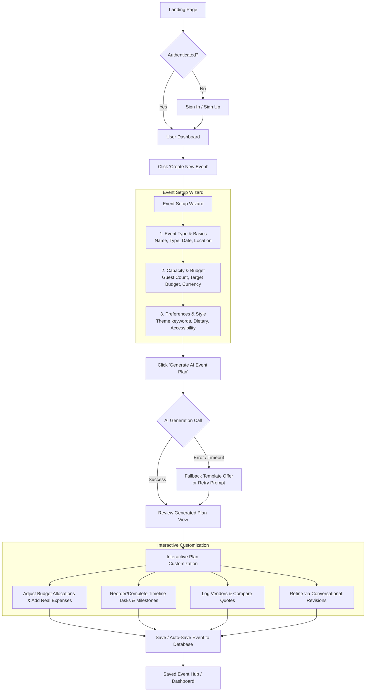
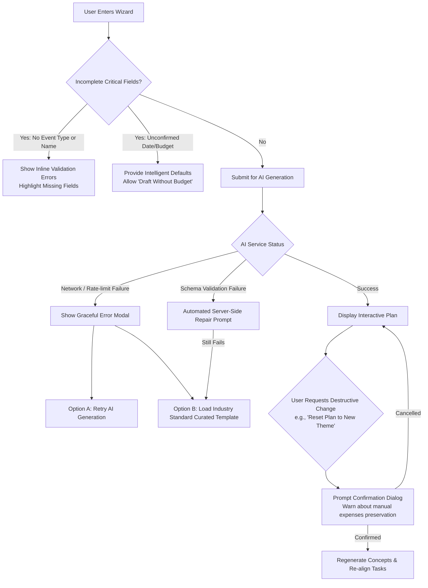

# User Workflows & Journey Specification
## Project: EventCraft AI

---

### 1. Primary User Journey

---

### 2. Detailed Step-by-Step Flow

#### Step 1: Landing Page & Onboarding
- **Action:** User lands on the application, views value propositions (AI-assisted themes, deterministic budgets, milestone calendars), and clicks **Get Started**.
- **Alternative:** Existing user clicks **Sign In** and is redirected to their Dashboard.

#### Step 2: Event Initialization (Create Event Wizard)
- **Step 2A: Core Info:**
  - Event Type (`WEDDING`, `BIRTHDAY`, `COMMUNITY`).
  - Event Name (e.g. "Maya & Liam's Sunset Wedding").
  - Target Date (with relative timeline awareness).
  - Location/Venue format (e.g. "Outdoor garden in Austin, TX").
- **Step 2B: Scope & Economics:**
  - Estimated Guest Count (e.g. 150).
  - Total Target Budget and Currency (e.g. $35,000 USD).
- **Step 2C: Style & Constraints:**
  - Theme/Atmosphere tags (e.g., "Boho Rustic, Minimalist, Warm Lighting").
  - Dietary requirements (e.g., "Vegan options, Nut-free").
  - Accessibility requirements (e.g., "Wheelchair accessible ramps required").
- **Tolerance for Incomplete Input:**
  - If date is unconfirmed, system defaults to a relative 6-month planning horizon.
  - If budget is unconfirmed, system recommends a median range based on event type and guest count, or flags budget as "Unallocated".

#### Step 3: Plan Generation & Review
- **Execution:** User submits wizard. Server invokes structured GenAI prompt with strict Zod schema validation.
- **Review Screen:**
  - Executive Overview: Cohesive Theme Concept, Color Palette, and Key Highlights.
  - Budget Breakdown: Visual chart of categories (Venue, Catering, Photography, etc.) with allocated amounts and percentage breakdowns.
  - Milestone Roadmap: Phased timeline (e.g., 6 Months Out &rarr; 3 Months Out &rarr; 1 Month Out &rarr; Week Of).
  - Run-of-Show: Preliminary day-of schedule.
  - Recommended Vendor Checklists.

#### Step 4: Plan Editing & Customization
- **Budget Adjustments:** User can override any category limit; system rebalances the unallocated balance in real time.
- **Task Management:** User checks off tasks, adds personal tasks, changes due dates, or flags priorities.
- **Vendor Tracking:** User logs specific vendor candidates, records quotes, and toggles status to "Booked".

#### Step 5: Save & Revisit
- Events are saved to PostgreSQL with full relational integrity.
- From the Dashboard, users can view all their events, overall progress meters (% tasks completed, % budget allocated), and open any plan.

---

### 3. Alternative & Error Paths

#### A. Incomplete User Inputs
- Missing non-essential fields (e.g., theme keywords) &rarr; AI fills in best practices according to event type.
- Missing budget &rarr; System creates plan with percentage allocation templates and marks monetary values as $0 until specified.

#### B. AI Generation Failures / Latency
- AI requests timeout at 15s.
- On failure, user is never stranded: the system presents a **Curated Best-Practice Template** matched to the event type (e.g., Standard Wedding 12-Month Checklist & Standard 50/50 Budget Allocation) with the option to retry AI generation at any time.

#### C. Conversational Revision Safeguards
- Conversational changes that affect budget or existing custom tasks require clear differential confirmation:
  - *"Applying this revision will reallocate your Decor budget from $4,000 to $2,500. Your 3 booked vendor entries will be preserved. Proceed? [Confirm / Cancel]"*
